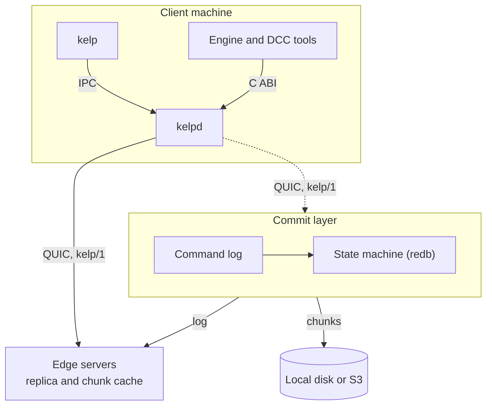

# Architecture

Every write becomes a command in a log, which a deterministic state machine applies to a redb database.
A server is in one of three roles:

- **all-in-one**: one process owns the log and the chunks.
- **edge**: replicates the log of an upstream and forwards writes to it.
- **commit group member**: agrees on the log with other members through Raft.

All three use the same data format.
An all-in-one server becomes the founder of a commit group, or the upstream of edges, without migration.

On the client, `kelp` and the C SDK are thin clients of `kelpd`, which runs workspace operations, watches workspaces and serves projected workspaces.
Every workspace operation is a serializable `Op` with an `Outcome`, so the CLI, kelpd and the SDK run the same code.

## Crates

| Crate | Purpose |
|---|---|
| `kelp-core` | ids, case-insensitive depot paths, typemaps |
| `kelp-cas` | chunking, file manifests, blob stores |
| `kelp-prolly` | history-independent prolly trees |
| `kelp-meta` | commands, the state machine, directory trees, locks |
| `kelp-proto` | the `kelp/1` wire protocol |
| `kelp-workspace` | views, pending changelists, hunk ownership, workspace state |
| `kelp-vfs` | projected workspaces: FUSE and ProjFS |
| `kelp-plugin` | the WebAssembly plugin host |
| `kelp-client` | server connections, the content cache, workspace operations |
| `kelp-daemon` | the engine of `kelpd` |
| `kelp-server` | the `kelp-server` binary |
| `kelp-cli` | the `kelp` and `kelpd` binaries |
| `kelp-sdk` | the C ABI for engine and DCC integrations |
